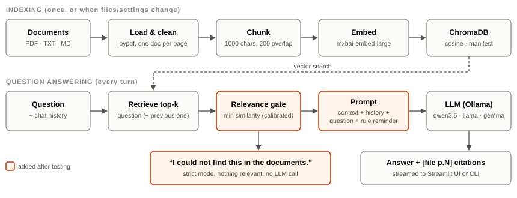
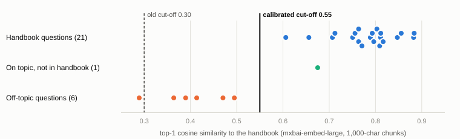

# 1. Introduction

Every Computer Science student at Fulbright University Vietnam (FUV) plans their studies with the
same document: the **Computer Science major handbook**, a 19-page PDF that sets out the degree
requirements, course prerequisites, academic policies and learning outcomes. Finding a single fact
in it, such as the prerequisites for CS 302 or the GPA needed for the Capstone, means scrolling
through tables and long paragraphs. A chatbot that answers such questions directly would save time,
but a general-purpose language model cannot do this on its own. It has never read this handbook, and
when asked how many credits the major requires, it will often give a confident number that is
simply wrong.

Retrieval-Augmented Generation (RAG) is designed for exactly this situation. Instead of relying on
what the model memorised during training, a RAG system first searches the documents for the passages
most relevant to the question, and then asks the model to answer from those passages only. Because
every answer is built from a specific passage, the system can also cite the page it came from, so
the student can check the answer for themselves.

The starting point of this project was the course's baseline script, `run_txt.py`, a single file
that performs RAG over plain text files. I extended it into a complete application for the CS
handbook: it reads PDF files (Task 1), answers handbook questions with page citations and follows
the conversation (Task 2), runs in Docker (Task 3), and offers a web interface (Task 4). Beyond
building these features, I wanted to answer two practical questions: how much does the choice of
language model matter, and what goes wrong when the system is actually used? To answer them,
I compared six models, from 0.5 to 9 billion parameters, on 27 handbook questions and checked every
answer by hand.

The rest of the report follows the same order. Section 2 describes the architecture, and Section 3
explains how each task was implemented. Section 4 presents the evaluation of the six models.
Section 5 describes the problems I found by using the finished system and how I fixed them; these
fixes, rather than the initial design, produced the most valuable improvements. Section 6 closes
with the lessons learned, the remaining limitations and possible future work.

# 2. System architecture

The system has two paths, shown in Figure 1. The **indexing** path prepares the documents once,
and the **question-answering** path runs every time the user asks something. All of the logic lives
in one Python package (`source_code/rag/`), which is shared by the command-line interface
(`cli.py`), the Streamlit web app (`app.py`) and the evaluation scripts. Because of this, every
number in this report was produced by exactly the same code that a user runs.

{width=100%}

**Indexing.** Each document is loaded page by page and split into chunks of about 1,000 characters,
with 200 characters of overlap so that a sentence cut at a boundary still appears whole in one of
the chunks. Every chunk remembers the file and page it came from, which is what later makes
citations possible. The chunks are turned into vectors with the `mxbai-embed-large` embedding
model, served by Ollama, and stored in a ChromaDB database that measures cosine similarity. The
19-page handbook produces 61 chunks. The baseline reused whatever was stored in its vector folder
forever, so editing a document had no effect. To fix this, I save a small manifest with a hash of
every file and the chunking settings, and the index is rebuilt automatically whenever either of them
changes.

**Answering a question.** When a question arrives, the five most similar chunks are retrieved. If it
is a follow-up such as "What is its prerequisite?", the previous question is searched as well, so
that "its" can be resolved to the course discussed one turn earlier. Chunks whose similarity is
below a threshold are discarded, and the remaining ones are given to the model as labelled passages
such as `[CS_MajorHandbook.pdf p.13]`. In the default **strict mode**, the model is told to answer
only from these passages, to cite their labels, and to reply "I could not find this in the
documents." when the answer is not there. The last three turns of the conversation are included so
that the chat feels natural. The code can talk to any Ollama server; I used a self-hosted GPU server,
and no document or question is ever sent to a third-party API.

# 3. Implementation

## 3.1 Task 1 — PDF support

The baseline only read `*.txt` files. I replaced this with a small set of loaders chosen by file
extension, so the same folder can now contain PDF, TXT and Markdown files. PDFs are read with the
**pypdf** library, and each page becomes a separate document tagged with its page number. Text
extracted from PDFs is often messy, so before chunking I normalise ligatures (for example "fi"
becomes "fi"), re-join words that were hyphenated across lines, and remove the dotted leaders of the
table of contents.

Not every page contains text that can be extracted. Page 10 of the handbook, the curriculum map, is
an image, so instead of silently indexing an empty page, the loader prints a warning that the page
needs OCR. A damaged file is likewise logged and skipped rather than stopping the whole run. For the
Task 1 demonstration, the folder `data/docs/` mixes the three original text files with the handbook
PDF. A single `ingest --rebuild` command indexes all four files into 115 chunks, and opening the
resulting database shows each PDF chunk stored together with its page metadata (Figure 2).

{width=92%}

## 3.2 Task 2 — Handbook chatbot

I chose the Computer Science handbook as the knowledge base. On top of the pipeline described above,
two features make the chatbot genuinely useful to a student. Citations let the student open the
handbook at the right page and check the answer, and follow-up handling lets them ask short
questions in a natural conversation. Section 4 evaluates how well both work.

## 3.3 Task 3 — Docker deployment

The Docker image is based on `python:3.11-slim`, runs as a non-root user, and includes a health
check on Streamlit's health endpoint. The same image can start either the web interface or the
command-line tool. The Docker Compose file makes three deliberate choices. First, the documents are
mounted from the host, so adding a new PDF does not require rebuilding the image. Second, the
vector database is kept in a named volume, so the embeddings survive container restarts and are not
recomputed on every start. Third, Ollama stays outside the container, because the language models
are large and need a GPU; the container reaches it through `host.docker.internal` or through a server
address set in `docker/.env`, which is kept out of Git. The Task 3 video shows the image being built,
the container reported as healthy, and a question answered from inside it (Figure 3).

{width=92%}

## 3.4 Task 4 — Web interface

The Streamlit web app (Figure 4) presents a chat in which answers appear word by word and earlier
messages stay visible. Under each answer, an expandable list shows the passages that were used, with
their similarity scores, so the user can see why the model answered as it did. A sidebar shows
whether Ollama is reachable and lets the user choose the language model, the number of retrieved
chunks, the temperature and strict mode. It also allows uploading new files, which are indexed
immediately, and exporting or clearing the conversation. If the model server cannot be reached, the
error is shown inside the chat instead of crashing the page. Finally, a suite of 18 automated tests
checks loading, re-indexing, prompt construction, refusals and network retries without needing a
running Ollama server.

{width=86%}

# 4. Evaluation

To find out how well the chatbot works, and how much the choice of language model matters, I wrote
27 test questions from the handbook, each with a reference answer and the page where the answer
appears. Most of them ask about requirements, policies, courses and learning outcomes. The others
were chosen to test difficult situations: two ambiguous questions, one question that sounds relevant
but is not answered in the handbook (the tuition fee), two questions that have nothing to do with the
handbook, and three follow-up questions. At first I also computed an automatic keyword score, but it
proved misleading: an answer could contain the right number and still invent the rest. I therefore
read and labelled all 162 answers by hand as *correct*, *incomplete*, *ambiguous* or *incorrect*.
For the four questions that should not be answered, a refusal counts as correct. All six models,
ranging from 0.5 to 9 billion parameters, used the same retrieval settings, strict mode and a
temperature of 0.2.

| Model | Correct | Incomplete | Ambiguous | Incorrect | Answerable correct | Correct refusals | Latency (s) |
|---|---|---|---|---|---|---|---|
| qwen3.5:9b | 24 | 0 | 1 | 2 | **20**/23 | 4/4 | 17.8 |
| gemma3:4b | 23 | 0 | 2 | 2 | **19**/23 | 4/4 | 11.3 |
| llama3.2:3b | 22 | 1 | 2 | 2 | **18**/23 | 4/4 | 9.4 |
| qwen2.5:3b | 20 | 0 | 2 | 5 | **16**/23 | 4/4 | 7.3 |
| qwen3.5:0.8b | 16 | 1 | 3 | 7 | **12**/23 | 4/4 | 9.6 |
| qwen2.5:0.5b-instruct | 12 | 4 | 2 | 9 | **10**/23 | 2/4 | 6.6 |

*Table 1. Manual labels per model (27 questions). Retrieval found an expected page for 22 of 23 answerable questions for every model. Latency was measured on a shared GPU server and is only indicative.*

The results in Table 1 show a clear divide. The models with 3 to 9 billion parameters answered 18
to 20 of the 23 answerable questions correctly and refused all four questions that they should not
answer. Among them, gemma3:4b was almost as accurate as the largest model while taking only about
60 % of its time, which makes it the best trade-off on this hardware. The two models below one
billion parameters were clearly weaker, and the course's default model, qwen2.5:0.5b, was the only
one that answered questions it should have refused. All six models did well when the whole answer
sat in one short passage. For example, every model answered that the Capstone course requires "a
minimum major GPA of 3.5" and cited page 9, and every model correctly resolved the follow-up "What is
its prerequisite?".

The failures were more instructive than the successes, and most of them can be traced to a specific
cause:

- **Lists that share a chunk get mixed up.** The major and minor requirements are two consecutive
  lists on page 7, so they end up in the same chunk. The small models blended them, and one even
  claimed that a minor must be completed before declaring the major.
- **Small models invent details.** qwen2.5:0.5b made up course names and a tuition fee of "$10,000
  per year".
- **Some passages are never retrieved.** The universities whose programs inspired the curriculum
  are mentioned in one appendix sentence attached to the end of a Bioinformatics course
  description. That chunk is "about" bioinformatics, so it never ranks highly, and every model
  failed this question.
- **Tables lose their structure.** pypdf flattens the course catalogue into lines such as "CS210
  Computer Networks On holding CS201", which the models misread as a schedule.
- **Scanned content is invisible.** Because page 10 is an image, the curriculum map cannot be
  retrieved at all.

# 5. Problems found by using the system

The evaluation above measures the final system, but the most important fixes came earlier, from
using the application myself. The most serious problem appeared in a simple conversation. After two
questions about CS311, I asked "Who won the 2022 FIFA World Cup?" with strict mode switched on, and
the qwen3.5:0.8b model answered "Brazil", which is both wrong and against the rule.

Two causes combined to produce this answer. The first was the relevance threshold. The baseline's
value of 0.3 had been designed for a different similarity score, and with `mxbai-embed-large` even
the word "hello" reaches 0.50, so the filter let everything through. When I measured both kinds of
question (Figure 5), handbook questions scored between 0.61 and 0.88 and off-topic questions between
0.29 and 0.50, so I raised the threshold to 0.55. The second cause was that small models tend to
forget instructions placed in the system prompt once a few chat turns follow it. Repeating the rule
in one sentence directly after the question turned zero correct refusals out of three into three out
of three. As a final safeguard, when no passage passes the threshold, the system now returns the
refusal directly, without calling the model at all.

{width=100%}

Fixing this has a cost, and I measured it by running the same 27 questions twice with the old pipeline and twice with the fixed one. The old pipeline answered all three off-topic questions from
memory in both runs and refused only one of the four questions it should have refused. The fixed
pipeline refused all four. In exchange, the 0.8B model answered about one and a half fewer of the 23
answerable questions correctly, usually because it added "I could not find this in the documents."
after an otherwise correct answer. For a handbook assistant I consider this the right trade-off: an
awkward but honest answer is far better than a confident and wrong statement about a university
policy. The larger models rarely show this effect.

Finally, I compared retrieval settings on their own, without any language model. With smaller
chunks of 500 characters, the correct page was ranked first for 91 % of the answerable questions,
compared with 81 % for the 1,000-character chunks used above, and the appendix question that every
model failed was answered correctly. A larger embedding model, `qwen3-embedding:8b`, separated
off-topic questions from handbook questions much more clearly, but it is much slower and would need
its own threshold. Both observations show that the threshold must be measured again whenever the
retrieval settings change.

# 6. Lessons, limitations and conclusion

The clearest lesson is that retrieval was rarely the weak point. The right page was retrieved for
96 % of the answerable questions, yet most errors happened afterwards, while the model was *reading*
the passage: it mixed up two lists, misread a flattened table, or stopped early in a long list.
Model size mattered most for faithfulness rather than fluency, since every model wrote fluent text
but only the larger ones stayed close to the source. I also learned that a similarity threshold
belongs to a particular embedding model and has to be measured rather than copied, and that small
models follow an instruction much more reliably when it is placed next to the question. Behaviour
that must never fail, such as refusing when nothing relevant was found, is safer in code than in a
prompt. Finally, an evaluation set must contain the cases one is afraid of. My first version had no
off-topic or follow-up questions, so it reported no problems at all, and the most serious bug only
appeared when I used the application myself.

The system still has clear limitations, and each suggests future work. Image-only pages such as the
curriculum map need OCR, and tables need an extraction method that keeps their columns. Splitting
the handbook at its section headings, instead of at a fixed length, would stop unrelated text from
sharing a chunk. Combining keyword search with the current vector search would help with exact
course codes such as "CS302". Follow-up questions should be rewritten into standalone questions
before retrieval, because an off-topic follow-up can currently borrow the relevance of the previous
question. The evaluation would also be stronger with repeated runs and a second person labelling the
answers.

In summary, the project turned a single-file baseline into a tested RAG application. It reads PDF
documents with page-level citations, offers both a command line and a web interface with
conversation history, runs in Docker with a persistent index, and comes with an evaluation harness.
With a 3–4 billion parameter model it answers most handbook questions correctly and points the
student to the right page, and it refuses, rather than guesses, when the handbook does not contain
the answer.
