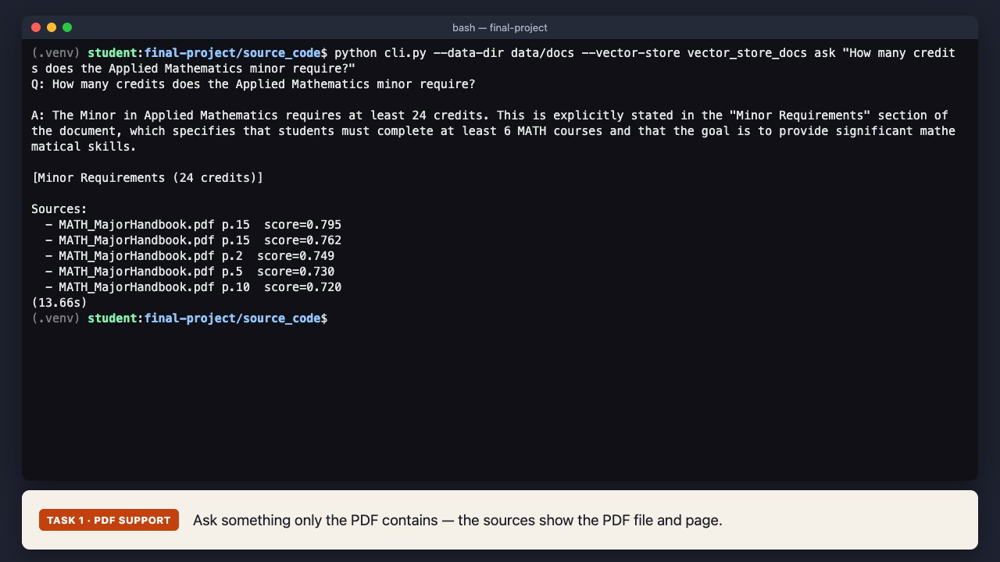
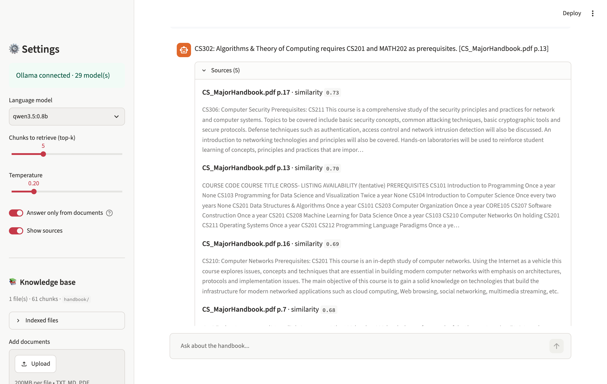
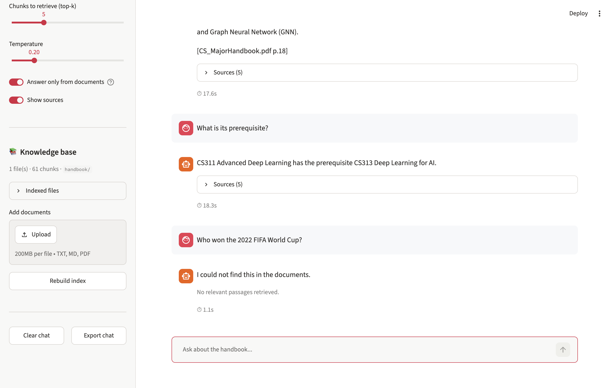
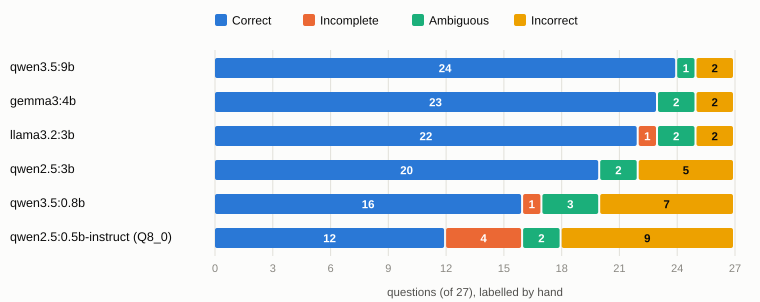

# 1. Introduction

Large language models answer fluently, but they do not know the content of a specific university
handbook and will happily invent course codes, credit counts and policies when asked. Retrieval-Augmented
Generation (RAG) addresses this by searching a document collection first and giving the model the
passages it should answer from. In this project I extended the course's baseline script
(`run_txt.py`, a single-file RAG over `.txt` files) into a small, tested RAG application for the
**Computer Science major handbook** of Fulbright University Vietnam (FUV).

The work covers the seven tasks of the brief: PDF support (Task 1), a handbook chatbot with a
systematic evaluation (Task 2), Docker deployment (Task 3), a web interface (Task 4), this report
(Task 5), four demo videos (Task 6) and a documented GitHub repository (Task 7). Beyond the required
features, most of my effort went into *using the system and fixing what broke*: the most valuable
improvements in this report came from failures I observed while testing the finished application,
not from the initial design.

# 2. System architecture

{width=100%}

The system is a Python package (`source_code/rag/`) with two front-ends that share it: a command-line
interface (`cli.py`) and a Streamlit web app (`app.py`). An evaluation script (`evaluate.py`) and a
retrieval experiment (`retrieval_sweep.py`) use the same package, so every number in this report was
produced by the same code the user runs.

| Module | Responsibility |
|---|---|
| `config.py` | All settings with defaults, overridable by environment variables or `.env` |
| `loaders.py` | Turns `.pdf`, `.txt` and `.md` files into LangChain `Document`s, one per PDF page |
| `indexer.py` | Chunking, embedding, ChromaDB persistence and a manifest for automatic re-indexing |
| `prompts.py` | Prompt templates (strict grounding and general-knowledge modes) |
| `pipeline.py` | Retrieve → build prompt (context + history) → generate; also the streaming variant |
| `models.py` | The only place that talks to Ollama (embeddings, chat model, health check) |

**Indexing.** Documents are loaded page by page and split with LangChain's
`RecursiveCharacterTextSplitter` (1,000 characters with 200 characters of overlap, splitting on
paragraphs, then lines, then sentences). Each chunk keeps its source file and page number. Chunks
are embedded with **`mxbai-embed-large`** (1,024 dimensions) served by Ollama and stored in a
persistent **ChromaDB** collection configured for **cosine distance**, so `1 − distance` is a
similarity in [0, 1]. The CS handbook (19 pages) produces 61 chunks.

A small `manifest.json` stored next to the vectors records a SHA-256 hash of every indexed file
and the chunking/embedding settings. On start-up the index is rebuilt only when these differ. The
baseline reused whatever was in `vector_store/` forever, so editing a document or switching the
embedding model silently served stale (or dimension-mismatched) vectors.

**Retrieval.** The top-k (default 5) chunks are retrieved for the question. For follow-up
questions, the previous user question is concatenated with the new one and searched as well, and
the two result lists are merged by best score. This is what lets "What is its prerequisite?" find
the CS311 page after a question about CS311. Chunks below a minimum similarity are dropped
(Section 6 explains how this threshold is chosen).

**Generation.** The retrieved chunks are formatted as labelled passages
(`[CS_MajorHandbook.pdf p.13]`) inside a system prompt. In the default **strict** mode the model
must answer only from that context, cite the labels, and reply "I could not find this in the
documents." otherwise. A general-knowledge mode (the baseline's behaviour) can be switched on in
the UI. The last three question/answer pairs are sent as chat history. The chat model runs in
Ollama with temperature 0.2, an 8,192-token context window and a 1,024-token output cap; the
"thinking" phase of reasoning models such as qwen3.5 is disabled by default because small models
otherwise reason for minutes and sometimes return nothing.

**Where Ollama runs.** The code talks to any Ollama server through `OLLAMA_BASE_URL`. For
development I used a self-hosted Ollama server reached over HTTPS and protected by a bearer token
(`OLLAMA_API_KEY`), because it has more GPU memory than my laptop; with `ollama serve` on the same
machine the default `http://127.0.0.1:11434` works without any change. No document or question is
sent to a third-party API.

# 3. Implementation

## 3.1 Task 1 — PDF support

`loaders.py` replaces the baseline's `glob("*.txt")` with a table of loaders keyed by file extension
(`.pdf`, `.txt`, `.md`). PDFs are read with **pypdf**; every page with extractable text becomes one
document with metadata `source`, `page` and `total_pages`. Extracted text is cleaned before chunking:

- Unicode NFKC normalisation folds typographic ligatures ("fi" → "fi");
- words hyphenated across line breaks are re-joined;
- table-of-contents dot leaders ("Mission ........ 3") are removed;
- runs of spaces and blank lines are collapsed.

Pages with almost no text are reported instead of being indexed silently. In the CS handbook,
page 10 is an image (the curriculum map), so its content cannot be retrieved without OCR. A broken
file is logged and skipped rather than stopping the whole indexing run. To demonstrate Task 1, the
folder `data/docs/` mixes the three baseline FUV text files with the Applied Mathematics handbook
PDF; questions about the minor requirements are answered from `MATH_MajorHandbook.pdf p.10` while
"Where is the FUV campus?" is still answered from `FUV-general.txt` (Figure 2).

{width=92%}

## 3.2 Task 2 — Handbook chatbot

I chose the Computer Science handbook. Besides the pipeline above, the chatbot needed two things
to be usable in a conversation: citations, so a student can check the page, and follow-up handling,
so that pronouns refer to the course discussed one turn earlier. Both are covered in the evaluation
(Section 5).

## 3.3 Task 3 — Docker deployment

The `docker/` folder contains a `Dockerfile`, a `docker-compose.yml` and an `.env.example`. The image
is based on `python:3.11-slim`, installs the requirements in a cached layer, copies the source
code, and runs as a non-root user. A `HEALTHCHECK` polls Streamlit's `/_stcore/health` endpoint.
Compose adds three deployment decisions:

1. **Documents are a bind mount** (`../source_code/data:/app/data`), so adding a PDF needs no rebuild;
   `RAG_DOCS_SUBDIR` switches between the handbook (Task 2) and the mixed folder (Task 1).
2. **The vector store is a named volume** (`rag_vector_store`), so embeddings survive container
   restarts and the index is not rebuilt on every `up`.
3. **Ollama stays outside the container.** Models are large and need the GPU; the container reaches
   the host through `host.docker.internal` (with an `extra_hosts` entry for Linux) or any other server
   through `OLLAMA_BASE_URL` and `OLLAMA_API_KEY` in `docker/.env`, which is git-ignored.

The same image runs the web UI (default command) and the CLI
(`docker compose run --rm rag-app python cli.py ask "..."`). I verified the full cycle — build, start,
health check, CLI query inside the container, web UI on port 8501, `docker compose down` — and it
is recorded in the Task 3 video (Figure 3).

{width=92%}

## 3.4 Task 4 — Web interface

The Streamlit app (Figure 4) provides a chat panel with streaming answers and conversation history,
example questions for a first visit, and under every answer an expandable list of sources with
their similarity scores and the response time. The sidebar shows the Ollama connection status and
lets the user choose the language model (any model pulled on the server), top-k, temperature and
strict mode, upload new PDF/TXT/MD files (indexed incrementally), rebuild the index, and export or
clear the conversation. Connection or model errors are shown inside the chat instead of crashing
the page.

<figure><figcaption>The web interface. Top: an example question answered with a page citation; the expanded <i>Sources</i> list shows each retrieved passage with its cosine similarity. Bottom: a follow-up that only says “its” is resolved from the previous turn, and an off-topic question is refused in about one second without calling the model.</figcaption></figure>

## 3.5 Task 7 — Repository and tests

The README documents installation, configuration (every environment variable), CLI and web usage,
evaluation and Docker deployment, plus known limitations. A pytest suite (18 tests) runs without
Ollama by injecting LangChain's deterministic fake embeddings and a fake chat model; it covers PDF
loading and cleaning, manifest-based re-indexing, prompt construction with history, the refusal
paths, streaming, the threshold calibration, the citation example and the retry behaviour.

# 4. Evaluation method

**Test set.** `source_code/eval/cs_handbook_questions.json` holds 27 questions written from the
handbook. Each has a reference answer, the page(s) where the answer is, and keyword groups for an
automatic check.

| Category | # | Example |
|---|---|---|
| Program requirements | 4 | How many credits are required for the Computer Science major? |
| Academic policies | 4 | What are the eligibility criteria for enrolling in CS 401 Capstone I? |
| Course offerings | 7 | What are the prerequisites for CS 302? · Which language is used in CS 201? |
| Learning outcomes, career, teaching | 4 | What are the Program Educational Objectives (PEOs)? |
| Ambiguous / appendix | 2 | What degree is awarded after completing the degree requirements? |
| On topic but not in the handbook | 1 | What is the tuition fee for the Computer Science program? |
| Off-topic | 2 | Who won the 2022 FIFA World Cup? · Write a Python function that reverses a string. |
| Follow-up (asked after another question) | 3 | (after a CS311 question) "What is its prerequisite?" · (after a CS311 question) "Who won the 2022 FIFA World Cup?" |

The last two groups were added after I found the bugs described in Section 6: my first version of
the set had only one unanswerable question and no multi-turn questions, so it could not have
caught them.

**Metrics.** `evaluate.py` records, for every question and model, the answer, the retrieved chunks,
**retrieval hit** (an expected page is among the top-5 chunks), a **keyword score** (fraction of
keyword groups present in the answer), whether the answer is a **refusal**, and the **latency**.
Automatic scores are only a guide — qwen3.5:0.8b's answer to Q01 contains "56" (keyword score 1.0)
but also invents a credit breakdown — so I labelled all 162 answers of the main run by hand (and
the 81 answers of the repeat runs in Section 6):

- **correct**: accurate, nothing misleading added;
- **incomplete**: accurate but key parts missing;
- **ambiguous**: contradicts itself, or reproduces garbled or contradictory source text;
- **incorrect**: wrong key fact, invented detail, refusing an answerable question, or answering an
  off-topic one. For the four questions that should be refused, a refusal is labelled correct.

**Models.** Six chat models from 0.5 to 9 billion parameters, all served by Ollama with the same
retrieval (mxbai-embed-large, 1,000/200 chunks, top-5, calibrated threshold), strict mode and
temperature 0.2: the course default **qwen2.5:0.5b** (instruct, Q8_0), **qwen3.5:0.8b** (my default),
**llama3.2:3b**, **qwen2.5:3b**, **gemma3:4b** and **qwen3.5:9b**. Every model saw exactly the same
questions; follow-up questions were asked after the model's own answer to the previous question.
The labelled run is in `source_code/eval/results/final/` (`results.csv`, `summary.md`,
`labels_summary.md`).

# 5. Results

{width=100%}

| Model | Correct | Incomplete | Ambiguous | Incorrect | Answerable questions correct | Correct refusals | Mean latency (s) |
|---|---|---|---|---|---|---|---|
| qwen3.5:9b | 24 | 0 | 1 | 2 | **20**/23 | 4/4 | 17.8 |
| gemma3:4b | 23 | 0 | 2 | 2 | **19**/23 | 4/4 | 11.3 |
| llama3.2:3b | 22 | 1 | 2 | 2 | **18**/23 | 4/4 | 9.4 |
| qwen2.5:3b | 20 | 0 | 2 | 5 | **16**/23 | 4/4 | 7.3 |
| qwen3.5:0.8b | 16 | 1 | 3 | 7 | **12**/23 | 4/4 | 9.6 |
| qwen2.5:0.5b-instruct (Q8_0) | 12 | 4 | 2 | 9 | **10**/23 | 2/4 | 6.6 |

*Table 1. Manual labels per model (27 questions). Latency is the mean over the 23 answerable questions on a shared remote GPU server and is only indicative. Retrieval found an expected page for 22 of the 23 answerable questions (96 %) for every model, since retrieval does not depend on the chat model.*

**Overall.** qwen3.5:9b, gemma3:4b and llama3.2:3b answered 18–20 of the 23 answerable questions
correctly and refused all four questions that should be refused; qwen2.5:3b followed with 16/23,
losing points mainly by refusing answerable questions. The two sub-1B models were clearly weaker: qwen3.5:0.8b got 12/23 right (though it
refused correctly every time) and the course's default qwen2.5:0.5b only 10/23, and it is the only
model that answered unanswerable questions (2 of 4). Larger was not strictly better per second:
gemma3:4b was almost as accurate as qwen3.5:9b at about 60 % of its latency, which makes it the best
trade-off on this hardware. Several questions were answered correctly by all six models — the
Capstone GPA rule (Q06, page 9), the CS311 prerequisite (Q09), the Android/Java project in CS207
(Q14) and the follow-up "What is its prerequisite?" (Q25) — all cases where one short passage
contains the whole answer.

**Correct, with a citation.** "What are the eligibility criteria for enrolling in CS 401 Capstone
I?" → "A minimum major GPA of 3.5 and approval of a successful application [CS_MajorHandbook.pdf
p.9]" (every model). "Which programming language is mainly used in CS 201?" → "Java, though some
Python/C++ implementations are also introduced" (qwen3.5:9b, llama3.2:3b).

**Incorrect — and why.**

- *Lists that share a chunk get merged.* The major and the minor requirements are consecutive
  lists on page 7 and end up in the same chunk. Asked which courses the major requires, the sub-1B
  models answered with the declaration rule and the minor's six courses (Q02), and qwen3.5:0.8b added
  that a student "must complete a minor" before declaring the major (Q03) — which the handbook never
  says. The larger models separated the two lists correctly.
- *Invented details.* qwen3.5:0.8b answered "56 credits" (right) but added a non-existent "40
  general-curriculum + 16 major credits" breakdown (Q01); qwen2.5:0.5b invented courses ("Advanced
  Discrete Mathematics", Q13) and a tuition fee of "$10,000 per year" (Q21).
- *Retrieval miss.* "Which universities' programs were used as references for the CS curriculum?"
  (Q22) failed for every model: the answer (Stanford, Carnegie Mellon, Cornell) is a short appendix
  sentence glued to the end of the Bioinformatics course description on page 19, so that chunk is
  "about" bioinformatics and never ranks in the top 5. The 3–9B models refused (a safe failure); the
  smaller ones answered with something else from the context.
- *Answer buried in a paragraph.* The alternative to the capstone (Q07: "take two more intermediate
  or advanced courses to graduate without honors") is one clause in a long paragraph on page 8. The
  page was retrieved, but no model extracted it; gemma3:4b even claimed students "can complete a group
  presentation instead".

**Incomplete.** llama3.2:3b listed the major's courses but skipped CS 203 and CS 302 (Q02);
qwen3.5:0.8b covered concurrency and memory management for CS 211 but not file systems (Q12). Long
lists are where small models stop early.

**Ambiguous.** (1) *The handbook is wrong.* Asked which degree is awarded (Q20), all six models
answered "Bachelor of Science in Applied Mathematics", faithfully quoting a copy-paste error in the
CS handbook. A RAG system cannot be more correct than its source. (2) *Flattened tables.* The course
catalogue row "CS210 Computer Networks On holding CS201" mixes the availability and prerequisite
columns; models answered "offered on holding CS201" or read "On holding" as "offered on a specific
cycle". (3) *Half refusals.* Small models sometimes gave the right answer and then appended "I could
not find this in the documents." — following the refusal rule and the context at the same time.

**Follow-up questions.** "What is its prerequisite?" after a question about CS311 was resolved by
all six models, and "And how often is it offered?" after a CS302 question by four of six (qwen2.5:3b
refused, qwen2.5:0.5b answered "None"). The off-topic follow-up (Q27) was refused by every model
except qwen2.5:0.5b, which answered "South Korea and Japan" (Section 9 explains why it got past the
threshold).

# 6. Problems found by using the system, and how I fixed them

I treated the finished application as a user would: I asked questions in the web UI and the CLI,
switched models, uploaded documents, exported chats, ran the Docker image and recorded the demos.
Several real defects appeared that neither the unit tests nor the original evaluation set had
caught.

**6.1 Off-topic questions were answered from memory in strict mode.** After two questions about
CS311, I asked "Who won the 2022 FIFA World Cup?". With "Answer only from documents" switched on,
qwen3.5:0.8b answered "Brazil, which defeated Argentina in the final" (wrong, and against the rule).
Two causes combined:

1. *The relevance threshold did nothing.* The baseline's cut-off of 0.3 was written for a different
   score (`1/(1+L2 distance)`), and I had kept the number after switching to cosine similarity and to
   `mxbai-embed-large`. With this model even "hello" scores 0.50 against the handbook, so every
   question passed. Measuring both groups (Figure 6) shows a clean gap: handbook questions
   score 0.61–0.88, off-topic ones 0.29–0.50. The default is now **0.55 for mxbai-embed-large**
   (0.3 is kept for other models until measured), and `RAG_SCORE_THRESHOLD` still overrides it.
2. *Small models forget the system prompt.* With the context in the system message and a few chat
   turns after it, the 0.8B model followed the most recent text. Repeating one sentence of the rule
   right after the question — "Answer only from the CONTEXT ... otherwise reply exactly: I could not
   find this in the documents." — turned 0/3 refusals into 3/3 in a direct test with the same
   retrieved context and history.

I also made the refusal **deterministic**: in strict mode, when no chunk passes the threshold, the
pipeline returns the refusal without calling the model at all (and answers in about one second).

{width=100%}

**6.2 Fabricated citations.** While recording the Task 1 demo, the 0.8B model answered a question
about the Applied Mathematics handbook and cited `[CS_MajorHandbook.pdf p.1]` — a file that was not
even in that index. It was copying the example citation written in the prompt. The example is now
the label of the top retrieved chunk, so a copied example is at least a real source.

**6.3 A dropped connection lost a 30-minute evaluation.** The six-model run died at question 18
of the third model with `Failed to connect to Ollama`, and because `evaluate.py` wrote its files only
at the end, the 71 finished answers were lost. The same kind of drop appeared in the web UI as
"Connection reset by peer". Ollama requests are idempotent, so the pipeline now retries transient
network errors (connection refused/reset, HTTP 502–504) with a short back-off, without restarting a
half-streamed answer; `evaluate.py` additionally retries per question, records a failed question
instead of aborting, and saves its results after every model. In the final run one drop happened
and was recovered automatically.

**6.4 Interface bugs.** (a) *Export chat* always missed the newest question and answer, because the
download content was computed when the sidebar was drawn, before the answer existed; the buttons are
now drawn at the end of each run. (b) After an upload, the "files · chunks" summary showed the old
counts until the next interaction. (c) The example-question buttons stayed above the first answer.
(d) After a connection error, the message also said "No relevant passages retrieved", which was
misleading. All four are fixed and checked in the browser.

**6.5 Smaller issues.** The Task 1 demo folder contained no PDF at all (only the three baseline text
files), so I added the Applied Mathematics handbook; verbose CLI output was flooded by pypdf
cross-reference warnings and one HTTP log line per request (which also printed the server address);
and extra vector-store folders such as `vector_store_docs/` were not git-ignored.

**Before and after.** To check that the fixes helped and to see what they cost, I ran the same 27
questions with qwen3.5:0.8b twice on the original pipeline and twice on the fixed one, and labelled
all four runs (Table 2). The fixes did what they were meant to do: in both runs every question that
should be refused was refused, including the off-topic question asked mid-conversation, while the
original pipeline answered all three off-topic questions from memory in both runs, with wrong World
Cup facts and, twice, a fabricated handbook citation. The cost was about 1.5 answerable questions out of 23 for
this smallest model, consistently across the two runs. The visible mechanism is the "half refusal":
with the rule repeated next to the question, the 0.8B model more often appends "I could not find
this in the documents." to a correct answer, and it answered the course-list question (Q02) with the
declaration rule in both fixed runs. For a handbook assistant I consider this the right trade-off —
a wrong policy stated confidently is worse than an awkward but correct answer — and the 3–9B models
in Table 1 rarely show the effect.

| Pipeline (qwen3.5:0.8b) | Run | Answerable correct (of 23) | Correct refusals (of 4) | Off-topic questions answered from memory |
|---|---|---|---|---|
| Original (threshold 0.3, no reminder, no gate) | 1 | 14 | 1 | 3 — World Cup ×2, Python code |
| Original | 2 | 14 | 1 | 3 — World Cup ×2, Python code |
| Fixed (calibrated threshold, gate, reminder, real citation example) | 1 | 12 | **4** | **0** |
| Fixed | 2 | 13 | **4** | **0** |

*Table 2. Before and after the fixes of Section 6, two runs each, labelled by hand.*

# 7. Retrieval experiment: chunk size and embedding model

Retrieval can be evaluated without any language model, so `retrieval_sweep.py` re-indexes the
handbook for each combination of embedding model and chunk size and checks, for the 21 answerable
single-turn questions, whether a chunk from an expected page is ranked first (hit@1), in the top 3 or
in the top 5, plus the mean reciprocal rank (MRR). It also records the top-1 similarity of the
weakest handbook question and of the strongest off-topic question, i.e. how much room a threshold has.

| Embedding model | Chunk size (overlap) | Chunks | hit@1 | hit@3 | hit@5 | MRR | Lowest handbook top-1 | Highest off-topic top-1 |
|---|---|---|---|---|---|---|---|---|
| mxbai-embed-large | 500 (100) | 118 | 0.91 | 1.00 | 1.00 | 0.94 | 0.65 | 0.54 |
| mxbai-embed-large | 1000 (200) | 61 | 0.81 | 0.91 | 0.95 | 0.87 | 0.61 | 0.47 |
| mxbai-embed-large | 1500 (300) | 43 | 0.76 | 0.86 | 0.91 | 0.82 | 0.61 | 0.44 |
| qwen3-embedding:8b | 500 (100) | 118 | 0.91 | 1.00 | 1.00 | 0.95 | 0.54 | 0.27 |
| qwen3-embedding:8b | 1000 (200) | 61 | 0.86 | 1.00 | 1.00 | 0.91 | 0.48 | 0.20 |
| qwen3-embedding:8b | 1500 (300) | 43 | 0.81 | 0.91 | 0.95 | 0.85 | 0.48 | 0.20 |

*Table 3. Retrieval-only comparison (21 answerable questions). The configuration used in the rest of
the report is mxbai-embed-large with 1,000-character chunks.*

Three observations:

1. **Smaller chunks retrieve better here.** With 500-character chunks every question finds an
   expected page within the top 3, including Q22: the appendix sentence about Stanford, CMU and
   Cornell becomes its own chunk instead of the tail of a course description. With 1,500 characters
   hit@1 drops to 0.76. The handbook is a list of short, self-contained facts, so precision beats
   context per chunk. The trade-off is that five 500-character chunks give the model half as much
   surrounding text, so the next experiment is 500-character chunks with a larger top-k, evaluated
   end to end.
2. **A stronger embedding model mostly helps the threshold.** qwen3-embedding:8b ranks slightly
   better than mxbai-embed-large at 1,000 characters (hit@5 1.00 vs 0.95, MRR 0.91 vs 0.87), but the
   bigger difference is separation: off-topic questions stay below 0.27 while handbook questions stay
   above 0.47, a far wider gap than mxbai's (0.47 vs 0.61). It is an 8B model, though, so indexing is
   much slower, and it would need its own calibrated threshold (around 0.4).
3. **The threshold must be re-measured when the configuration changes.** With 500-character chunks
   the strongest off-topic question reaches 0.54 under mxbai, right next to the 0.55 cut-off chosen for
   1,000-character chunks. The calibration table in `config.py` is keyed by embedding model only; a
   production version should key it by model and chunk size, or recompute it whenever the index is
   rebuilt.

# 8. Observations and lessons learned

- **Retrieval was rarely the bottleneck; reading was.** With the 1,000-character setup an expected page
  was retrieved for 22 of 23 (96 %) of the answerable questions, yet even the best model got only
  20 of 23 answerable questions fully right. Most errors happened *after* retrieval: mixing
  two lists that share a chunk (major vs. minor requirements on page 7), reading a flattened table,
  or stopping after the first item of a list.
- **Model size matters most for faithfulness, not fluency.** All six models write fluent answers. The
  0.5B model, however, invented a tuition fee ("$10,000 per year"), invented course names, and
  answered the World Cup question from memory even with the rule repeated next to it. The 3–9B
  models were faithful but sometimes *too* careful: qwen2.5:3b refused three answerable questions
  whose answer was in the retrieved context.
- **Similarity scores are model-specific.** A threshold is a property of an embedding model and a
  corpus, not a universal constant; it has to be measured, as in Figure 6.
- **Put the rule where the model looks.** For small models, an instruction right next to the question
  is followed far more reliably than the same instruction in the system prompt. For behaviour that must
  never fail (refusing when nothing relevant was found), code is better than a prompt.
- **RAG faithfully reproduces errors in the source.** The handbook's degree section says "Bachelor of
  Science in *Applied Mathematics*" (a copy-paste error from another handbook), and every model
  repeated it. Retrieval cannot fix the document.
- **PDF extraction quality limits everything downstream.** The course catalogue is a table that pypdf
  flattens into one line per course ("CS210 Computer Networks On holding CS201"), which models misread
  as "offered on holding CS201". The handbook's font also maps ligatures to the wrong characters, so
  pypdf extracts "Educa8onal Objec8ves", "Descrip;on" and "A2ributes", and page 10 is an image.
- **An evaluation set must contain the cases you are afraid of.** My first set had no off-topic or
  multi-turn questions and reported nothing wrong; the worst bug only appeared when I used the app.
- **Long jobs against a network service need to survive the network.** Retries and incremental saves
  are cheap compared with re-running a 30-minute evaluation.

# 9. Limitations and future work

- **OCR** for image-only pages (page 10, the curriculum map) with Tesseract or a vision model.
- **Table-aware extraction** (pdfplumber/Camelot) so each course row keeps its columns, and a
  ligature repair map for fonts like this handbook's.
- **Section-aware chunking**: split on the handbook's headings so that, for example, Appendix I is
  not glued to the Bioinformatics course description, which is why no model could answer Q22
  (Table 3 shows that halving the chunk size already fixes this particular case).
- **Hybrid retrieval and re-ranking**: BM25 for exact course codes ("CS302" vs "CS 302") combined
  with the dense retriever, plus a cross-encoder re-ranker for the top 20 chunks.
- **Better follow-up handling.** Concatenating the previous question lets an off-topic follow-up
  inherit the previous question's relevance and pass the threshold; the 0.5B model then answered the
  World Cup question ("South Korea and Japan"). Rewriting the follow-up into a standalone question
  with the LLM, and applying the threshold to that, would close this gap.
- **Evaluation**: one run per model at temperature 0.2 leaves run-to-run noise of a few questions;
  repeated runs (or temperature 0), a larger question set, and a second human labeller would make the
  comparison firmer. Latencies were measured on a shared remote GPU server and are only indicative.

# 10. Conclusion

The final system turns the course's single-file baseline into a tested RAG application for the CS
handbook: it reads PDFs with page-level citations, answers through a CLI and a Streamlit interface
with conversation history, runs in Docker with mounted documents and a persistent index, and comes
with an evaluation harness. The most useful lesson was that a RAG system has to be *used* and
*measured* together: running the app exposed a threshold that silently did nothing, a prompt that
small models ignored, copied citations, and fragile networking, and the evaluation then showed that
the fixes made the chatbot refuse what it should, at a small and measurable cost in answer quality
for the smallest model. With a 3–4B model it
answers most handbook questions correctly and cites the page; the remaining errors come mainly from
how the PDF's tables and sections reach the model.

# Appendix A. Demo videos

| Task | File in `demo_video/` | Length |
|---|---|---|
| 1. PDF support | `task1_pdf_support.mp4` | 2:23 |
| 2. Handbook chatbot | `task2_handbook_chatbot.mp4` | 3:38 |
| 3. Docker deployment | `task3_docker.mp4` | 1:57 |
| 4. Web interface | `task4_web_ui.mp4` | 2:53 |

Video links: _add the Canvas/Drive links here if the files are uploaded separately._

# Appendix B. Reproducing the results

```bash
cd source_code
pip install -r requirements.txt
python cli.py ingest
python evaluate.py --models qwen3.5:0.8b hf.co/Qwen/Qwen2.5-0.5B-Instruct-GGUF:Q8_0 \
    llama3.2:3b qwen2.5:3b gemma3:4b qwen3.5:9b --out eval/results/final
python retrieval_sweep.py --embed-models mxbai-embed-large qwen3-embedding:8b --chunk-sizes 500 1000 1500
pytest -q
```

